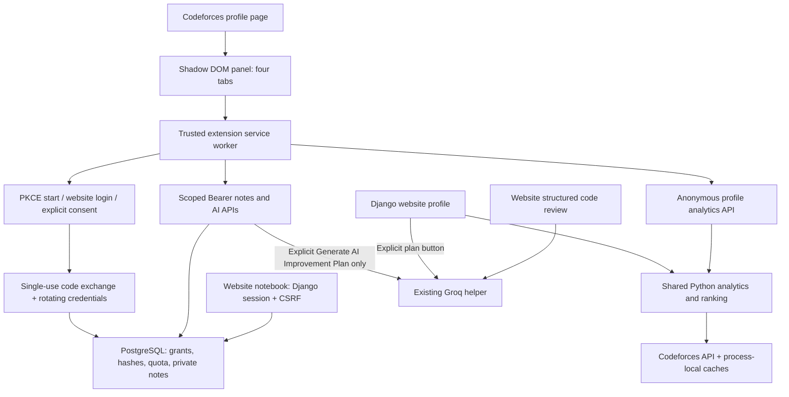

# Codeforces Profile Analytics Assistant — implementation report

For the subsequent production configuration, see [the deployment guide](deploy/README.md).
Statements below about unchanged deployment files describe the earlier profile/UI task.

Date: 16 November 2026. This report covers the profile-only redesign, shared website
analytics/notebook, and persistent extension account connection.

## 1. Completed changes

The extension now injects only on `https://codeforces.com/profile/{handle}`. Four isolated,
collapsible tabs provide Overview, Weaknesses, Practice, and Notes on the connected account's
linked profile. Other/public profiles show Overview only. Public deterministic
analytics load automatically without login. Tab switching reuses the loaded bundle;
navigation discards stale responses. Collapse preference persists locally. The panel
uses Codeforces-compatible typography/colors, responsive layout, and keyboard-accessible tabs.

Website profile analytics use the same Python calculations. Existing login, registration,
profile settings and rating charts/regression remain available. The website dashboard now
links analytics, AI code review, the notebook and extension connections. The standalone
Weak-Spot website tool has been retired; old links redirect to the profile without AI.
Code review now validates structured JSON, shows the problem statement, original code with
line-specific suggestions, focus topics, and complete suggested source. All text is escaped;
source is never executed. Canonical review URLs are restricted
to supported Codeforces problem routes, and redirects are not followed by the scraper.

## 2. Architecture

No Django REST Framework, frontend framework, Redis, Celery, or additional dependency was added.

## 3. Files

Created:

- `core/services/analytics.py`: distinct-problem/topic/verdict/rating/weakness calculations and deterministic ranking.
- `core/services/codeforces.py`: validation, upstream errors, cache/duplicate-load protection, bounded history, website adapter.
- `core/services/extension_auth.py`: PKCE, scope checks, opaque credential hashes, rotation/replay detection, CORS and HTTPS rules.
- `core/services/notebook.py`, `improvement.py`, `safe_markdown.py`, `urls.py`: shared private CRUD, on-demand AI/quota, safe output, URL validation.
- `core/profile_views.py`: public/private APIs, approval page, website notebook/connection management.
- `core/migrations/0003_profile_assistant.py`: additive schema and non-destructive legacy-note copy.
- `templates/core/profile_details.html`, `notes.html`, `extension_authorize.html`, `extension_connections.html`.
- `extension/content/codeforces-profile.js`, `extension/README.md`, `core/test_profile_platform.py`, `scripts/verify_project.py`.

Modified:

- Models/forms/settings/URLs, website view adapters, home/register redirect continuation, shared navigation,
  profile charts, dashboard and structured code-review screens.
- Manifest, background worker, API client, popup/options, regression/analytics/extension tests, and README.

Removed after consumer inspection:

- Problem-page content script, its message handlers, old problem-context/review/notebook/session API routes,
  obsolete `core/extension_views.py`, and their problem-specific helpers/tests.
- Obsolete problem-tools/Phase 1 instructions and the superseded `verify_phase1.py` runner.

The historical `MistakeNote` model, table, and migrations remain. Unrelated website tools and
the old unused standalone prediction template were not deleted. Pre-existing user changes
to `.env.example` were left alone. Docker files, requirements, deployment/cloud configuration,
and secrets were not modified. No commit or push was made.

## 4. Database migration

PostgreSQL connectivity was verified. `0003_profile_assistant` was applied; no migrations
are pending. It creates PersonalNote, ExtensionLinkRequest, ExtensionGrant,
ExtensionRefreshToken, and AIPlanQuota, plus Django's ordinary model metadata/permissions.

The migration copied the one existing problem note into the shared notebook, preserving
owner, source URL, mistake, lesson, topics, revision text, and historical timestamp. The
original note remains intact. The copy is linked to its legacy record and does not
overwrite an existing imported note. User and legacy-note table fingerprints matched
before and after the migration. No database/table reset or drop was performed.

## 5. Analytics and recommendations

- Current/max rating and rank, rated contests, unique solved problems, total/observed
  submissions, acceptance rate over final submissions, and pending count.
- Numeric solved-by-rating buckets and a separate unrated category. Stable contest ID/index
  or problemset ID/index keys; names never identify a problem.
- Multi-tag distinct attempted/solved counts and solve rates. Pending-only problems do
  not lower topic solve rates. Topic counts overlap rather than forming exclusive categories.
- Rating history, recent change, all-history regression trend, and last-15-contest linear
  regression estimates. Fewer than three contests do not produce forecasts.
- Final verdict distribution, repeated WA, frequent TLE/runtime signals, high-attempt problems,
  and difficulty-band performance. No verdict-to-root-cause claims.
- Weakness requires at least five distinct judged problems and eight final submissions
  per tag. Score = 65% unsolved-problem rate + 20% unsuccessful-submission rate + 15%
  repeated-unsuccessful signal. Average attempts includes all observed final submissions
  on solved problems. Low samples are marked insufficient, not weak.
- Three to five focus suggestions where available; non-weak consolidation/foundation
  suggestions are explicitly distinguished from measured weaknesses.
- Approximately eight practice candidates when the pool permits, hard rating bounds,
  solved exclusion, unseen-first ordering, extra weight for supported weak topics,
  diversity, canonical Codeforces URLs, and no duplicate IDs within a list.

Submissions are capped at 10,000 observed entries. A response at the cap is conservatively
marked incomplete, and missing stable IDs are disclosed. **Recommendations are withheld
when history is incomplete**, because older solved problems cannot be reliably excluded.
Other statistics explicitly describe the observed subset. The app does not silently
treat missing history as an empty complete history.

Rated bounds are rating ±200 (800 minimum, with a 1000 upper-bound floor for very low
ratings). Unrated bounds use typical observed difficulty capped at 800–1400; an empty
history starts at 800–1000. Recommendations remain stable within a cached bundle.

## 6. Private notebook

Title, content, optional topic, created/updated timestamps, owner, and optional legacy
link are stored in PostgreSQL. Both clients use the same CRUD/validation/serialization
service. Search, topic filter, latest-update sorting, pagination, edit, delete, and
optimistic conflict checks are implemented. Ownership is checked on every detail/write.

Viewing public profile B never changes connected account A. Notes are A's notebook,
clearly labeled. There is no public registered-handle/account-enumeration endpoint.
User text is escaped in both clients; token credentials never enter notebook content.

## 7. Authentication and lifecycle

Existing Django sessions authenticate website login/registration and the explicit approval
page. A safe relative `next` destination resumes connection after login or registration.
No extension password form or Codeforces ownership shortcut was introduced.

1. Worker generates random state and verifier; only S256 PKCE is accepted.
2. Backend checks allowlisted client ID and exact `https://<id>.chromiumapp.org/callback`.
3. The pending request lasts ten minutes. Website approval identifies the extension ID,
   account, and scopes and is protected by ordinary Django CSRF.
4. Approval issues a 90-second, single-use code bound to state, verifier, client, and request.
5. The worker verifies the callback and exchanges the code. Opaque credentials are returned
   only in the token response, never in an arbitrary website redirect.
6. Access expires after ten minutes; the grant lasts at most 30 days. Refresh rotates,
   old-refresh reuse revokes the grant family, and expired/revoked/inactive accounts fail closed.
7. Disconnect revokes remotely when reachable and removes local access. Website connection
   management can revoke a lost/offline browser's grant. Website logout is independent.

Server stores hashes, not raw access/refresh credentials. Scopes are `notes:read`,
`notes:write`, and `ai:generate`. Extension storage access is set to TRUSTED_CONTEXTS
before storing credentials; only the worker runs token-bearing operations. Tokens are
bound locally to the backend origin and are not forwarded after changing backend.

Private extension APIs reject cookie-only authentication; their CSRF exemption is limited
to mandatory Bearer/PKCE endpoints. Website cookie writes retain normal same-origin CSRF.
Production authentication requires HTTPS; loopback HTTP is allowed for development.
CORS reflects only explicitly configured extension origins, never a wildcard.

## 8. Automatic versus explicit AI

Automatic: public deterministic bundle, connection-status restoration, local preference
restoration. Notes load only on an authenticated Notes-tab visit on the linked profile. Tab switching does not reload
analytics or invoke Groq.

Explicit only: Generate AI Improvement Plan, note writes/deletes, Connect/Disconnect,
and the website review action. The new plan uses a small canonical
summary, not raw submission histories or private notes. Plans are structured and rendered
as escaped text. PostgreSQL enforces three plan attempts/hour/account and one active
request; successful identical summaries cache for 15 minutes. No automatic inference retry.

## 9. Endpoints

| Method | Path | Access |
| --- | --- | --- |
| GET | `/api/profiles/{handle}/analytics/` | Public deterministic bundle |
| GET | `/api/profiles/{handle}/weaknesses/` | Public, same cached calculations |
| GET | `/api/profiles/{handle}/practice/` | Public, deterministic |
| POST | `/api/extension/auth/start/` | Allowlisted PKCE client |
| GET/POST | `/extension/authorize/{request_id}/` | Website session + CSRF consent |
| POST | `/api/extension/auth/exchange/` | Single-use code + PKCE + state |
| POST | `/api/extension/auth/refresh/` | Rotating refresh proof |
| GET | `/api/extension/auth/status/` | Public disconnected state or validated Bearer |
| POST | `/api/extension/auth/revoke/` | Valid scoped Bearer |
| GET/POST | `/api/extension/notes/` | Bearer read/write scopes |
| GET/PUT/DELETE | `/api/extension/notes/{id}/` | Bearer + note ownership |
| POST | `/api/extension/improvement-plan/` | Bearer AI scope + durable quota |
| GET/POST | `/api/notes/` | Website session; CSRF for write |
| GET/PUT/DELETE | `/api/notes/{id}/` | Website session, CSRF, owner |
| POST | `/api/improvement-plan/` | Website session + CSRF + same quota |
| GET/POST | `/notes/` | Website notebook |
| GET/POST | `/extension/connections/` | Website session + CSRF revocation |

Explicit OPTIONS preflights are supported for extension APIs. Public profile loading is
IP-limited and cached; public throttles/caches use the existing process-local cache.

## 10. Verification

Baseline: PostgreSQL and Django checks passed. The old suite had 47/48 Python tests pass
and 18/18 Node tests pass. Its failure assumed there were no saved notes in the existing
database. Existing data was unchanged. That obsolete global-empty assertion was replaced
by owner-scoped tests for the new notebook.

Current checks: **60 Python tests passed**; the updated JavaScript suites cover 26 extension
tests and 4 website review interaction tests (30 total). Standard Django checks passed;
`makemigrations --check --dry-run` found no model drift; all three core migrations are
applied. Project Python files, Django templates, extension JavaScript and the website review script
are checked for syntax errors. Git whitespace checks passed.
Existing PostgreSQL table contents matched before and after transactional tests; both
legacy SQLite hashes still match the earlier audit. Dockerfile, .dockerignore, and
requirements.txt have no changes.
Tests cover analytics edge cases, minimum evidence, bounded recommendations, public access,
code/state replay, expiry, refresh reuse, revocation/scopes, consent/website CSRF, owner
isolation, shared website notes, legacy copy, caches/quotas, old website authentication,
structured review and retired-tool redirect, profile-only injection, automatic/no-AI loading, navigation, keyboard tabs,
notes CRUD, storage protection, and restoration after worker restart.

All test HTTP is mocked. PostgreSQL tests use rollback transactions, no test database
creation or table flushing; pre/post table fingerprints must match. Sequence IDs can
advance, leaving harmless gaps. Existing SQLite files/backups remain untouched.

Live local smoke checks: auth status HTTP 200, allowlisted auth preflight HTTP 204, and
removed problem-context endpoint HTTP 404. These do not call Codeforces or Groq.

## 11. Known limits

- Real Chrome consent popup/callback, visual layout at different widths, full browser
  restart, and live provider inference are not claimed verified. Node tests simulate APIs.
- Histories at/above the cap cannot provide complete totals or guaranteed practice
  exclusion; recommendation withholding is intentional until full history is available.
- Cold Codeforces bundles use several spaced, bounded upstream calls. Cross-process
  public caches/throttles would require shared infrastructure, which was not added.
- Linear regression is a trend extrapolation, not a validated contest-performance model.
- With the existing DEBUG=False setting, new static assets require local collectstatic
  and a development-server reload. This was completed without changing deployment settings.
- Existing deployment cookie/HTTPS/reverse-proxy settings and secrets were not changed.
  Production hosting still requires its own deployment review; this is not a deployment certification.
- Expired request/grant/token records are retained for replay checks/audit. Periodic
  retention cleanup is not scheduled by this task.

## 12. Manual Chrome checklist

1. Restart Django after environment changes. Reload the unpacked extension; review the
   new identity permission. Refresh old Codeforces tabs to remove old injected content.
2. Confirm the extension ID matches the backend allowlist. Options shows the ID. Set the
   intended backend URL and grant host access. Production URLs must use HTTPS.
3. Signed out/disconnected, open a Codeforces profile: Overview and its charts
   load automatically; Weaknesses, Practice and Notes must be hidden. Confirm no improvement-plan POST appears before an explicit click.
   Verify unrated/empty histories and any incomplete-history warning.
4. Open a problem/contest page: no CP Assistant UI should be injected. Navigate between
   profiles: data resets, stale responses are ignored. Switch tabs and collapse/expand:
   no repeated profile request. Check keyboard arrows/Home/End and narrow-screen scrolling.
5. Click Connect Account. Use the existing website login or registration, inspect the
   correct account/extension ID on consent, then approve. Cancel once and verify retry.
6. On another person's profile, confirm the header still names your Django account and
   only Overview is shown. Visit your saved Codeforces handle: all four tabs appear.
   Create/edit/search/filter/delete a temporary note;
   verify it on `/notes/` and after page reload. Test two-tab stale edits.
7. Restart Chrome and verify the connection restores without another consent. After access
   expires, the next private operation should renew silently. Never copy tokens into chat.
8. Disconnect or revoke via website Connections: the next private API operation must fail;
   public analytics stay available. Reconnect when desired. Check offline errors/retry.
9. Only with explicit approval for provider usage, click Generate AI Improvement Plan.
   Check one request, loading/error states, duplicate-click blocking, and advisory output.
   This implementation task made no paid live inference calls.
10. Check the updated dashboard at `/dashboard/`. Verify the four current tools, profile
    settings and owner-scoped counts. Old `/weak-spot/` links should redirect to `/profile/`.
11. On `/ai-review/`, inspect the editor at desktop and narrow widths. With separately
    approved provider usage, submit once and check problem text, issue line links, highlighted
    original source, full suggested source and copy buttons. The mocked tests do not verify
    a live model's response or the correctness of generated solutions.

## 13. Required action / delivery boundary

Database migration and automated implementation work are complete. The remaining user
actions are reloading the extension and performing the real-Chrome checklist. No new
credentials are required for mocked verification. Live AI testing needs explicit approval.
No deployment or cloud changes have been started.

Design references: [Chrome identity API](https://developer.chrome.com/docs/extensions/reference/api/identity),
[Chrome storage access levels](https://developer.chrome.com/docs/extensions/reference/api/storage),
[OAuth security BCP / PKCE and refresh rotation](https://www.rfc-editor.org/rfc/rfc9700.html),
and [Codeforces API methods](https://codeforces.com/apiHelp/methods).

## Latest UI follow-up

- Own-profile tab visibility uses the saved handle returned only through authenticated
  status/token responses. It is case-insensitive and does not establish Codeforces ownership.
- Overview has a rating/rank hero, six metric cards, a vertical difficulty distribution,
  topic pie with legend and explicit multi-tag semantics, trajectory and expandable details.
  Single-contest histories have a visible point; empty charts have clear placeholders.
- Website files: `templates/base.html`, `core/dashboard.html`, `core/code_review.html`,
  `core/code_lines.html`, `core/notes.html`; styles/scripts in `core/static/core/`.
  Review parsing/prompt construction is in `core/services/code_review.py`.
- New code-review responses are validated for shape, content limits and original line ranges;
  invalid/incomplete responses preserve source and offer an explicit retry. Source is capped
  at 40,000 characters, the response budget at 8,192 tokens. No automatic paid retry.
- No schema change or migration was needed for this follow-up. Existing PostgreSQL table
  contents matched before/after rollback-only verification. No Docker/deployment changes,
  credential changes, commits or paid provider calls were made.

Local UI smoke check: the existing server on port 8000 serves both new website assets
with HTTP 200; their response bytes match the source files. Collected files are in the
existing ignored staticfiles directory. This does not replace real browser visual testing.
