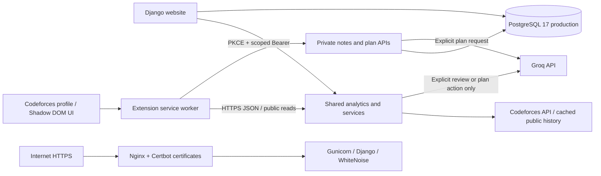

# CP Assistant

A Django competitive-programming workspace with Codeforces analytics, on-demand Groq
feedback, a private notebook and a Manifest V3 Chrome profile companion.

Production: **https://130-210-110-62.sslip.io**. The owner reports the Oracle Ubuntu ARM64
site, HTTPS/Certbot renewal, AI and extension are working. This repository audit does
not independently certify the live VM or its backups. See [the final audit](FINAL_AUDIT.md).

## Features

- Codeforces rating/rank, distinct solved questions, difficulty distribution, verdicts,
  acceptance rate, topic coverage and performance graphs.
- Linear-regression rating estimates, fitted on request from rating history. These are
  trend extrapolations, not guaranteed contest ratings; fewer than three contests yield
  no forecast. No external training dataset or stored model artifact is required.
- Evidence-based weak topics and deterministic practice recommendations. Weakness needs
  at least five distinct judged problems and eight final submissions per topic.
- Optional AI improvement plans, generated only after an explicit button click, with
  three attempts/hour/account, an in-flight lock and a 15-minute successful-result cache.
- Website AI code review: problem context, original code with line-specific suggestions,
  complexity, focus topics and complete suggested code. Source is never executed/judged.
- Private notes shared between website and extension: CRUD, search, topic filter,
  pagination and stale-edit conflict detection. Ownership is the Django account.
- Registration, login, profile settings, CSRF-protected POST logout and extension
  connection/revocation management.
- Extension Overview on public profiles: vertical rating bars, topic pie and trajectory.
  Weaknesses, Practice and Notes appear only on the connected account's saved handle.

The extension runs on `https://codeforces.com/profile/{handle}`, not problem/contest
pages. The standalone website Weak-Spot tool is retired; old bookmarks redirect to
profile analytics. Rival comparison is not part of the current feature set.

## Architecture



Django 5.2 LTS, Python 3.11 in Docker, vanilla JavaScript/Manifest V3, Bootstrap/Chart.js,
NumPy/scikit-learn, requests, BeautifulSoup, WhiteNoise and psycopg2. SQLite is supported
for local development; production settings always select PostgreSQL. No Redis, Celery,
Kubernetes or CI/CD pipeline is configured. Nginx is the only published container.

## Local setup (SQLite)

Use Python 3.11+ and Node.js for JavaScript tests. In Windows PowerShell:

```powershell
python -m venv .venv
.\.venv\Scripts\python.exe -m pip install -r requirements.txt
Copy-Item .env.example .env   # Fresh setup only: never overwrite an existing .env
```

Edit the ignored `.env`. Set a newly generated random `DJANGO_SECRET_KEY`,
`DB_ENGINE=sqlite`, loopback `ALLOWED_HOSTS`, and optional AI/extension configuration.
Generate secrets privately, never in committed files or shared command output.
The documented `.env.example` contains no real keys. Blank `AI_API_KEY` disables live AI.

```powershell
.\.venv\Scripts\python.exe -B manage.py migrate
.\.venv\Scripts\python.exe -B manage.py collectstatic --noinput
.\.venv\Scripts\python.exe -B manage.py runserver
```

Open `http://127.0.0.1:8000`. Local DEBUG remains False, so collect static assets and
restart the local server when introducing new assets. Sign up and save your Codeforces
handle in profile settings. Back up existing SQLite files before applying migrations;
this audit did not migrate or transfer any existing local database.

For local PostgreSQL, select `DB_ENGINE=postgresql` and set `DB_NAME`, `DB_USER`,
`DB_PASSWORD`, `DB_HOST`, `DB_PORT`. For compatibility, an existing environment with
`DB_NAME` and no `DB_ENGINE` keeps PostgreSQL. A fresh environment without either uses
SQLite. Choosing an engine does not move data between databases. Production ignores a
local SQLite selection and requires explicit PostgreSQL credentials.

## Chrome extension

1. Load `extension/` unpacked at `chrome://extensions` with Developer Mode enabled.
2. Put the displayed 32-letter ID in backend `EXTENSION_ALLOWED_IDS` (comma-separated
   exact IDs), or use `EXTENSION_ALLOWED_ORIGIN=chrome-extension://<actual-id>`.
3. Open extension Options. Set **https://130-210-110-62.sslip.io** for production, or
   `http://127.0.0.1:8000` for local development, and grant the selected host permission.
4. Open a Codeforces profile and choose **Connect Account**. Log in on the chosen
   Django backend and explicitly approve. No API keys or passwords belong in extension storage.
5. Your linked profile shows all four tabs; other profiles show Overview only. Own-profile
   display is a saved-handle match, not proof of Codeforces ownership.

The worker performs PKCE S256 with state checking and a single-use code. Access lasts
10 minutes; rotating renewal lasts until grant expiry (30 days) or revocation. Tokens
are hashed in PostgreSQL and stored only in trusted extension contexts. Requests use
`credentials: omit`; website cookies are used only in the top-level consent flow.
Backend changes require reconnection. In-flight authorization/refresh cannot bind old
credentials to a newly selected backend. Website logout ends its session; extension
access is separate and is revoked using Disconnect or website Connections.

Public analytics are automatic and deterministic. Groq runs only after explicit AI
review/plan actions. Tab switching and health checks do not generate AI requests.

## Production operation

Use [the Oracle deployment guide](deploy/README.md) for initial installation and renewal
commands. The current deployment already exists: **do not repeat fresh-database steps,
regenerate production secrets, change database passwords, or delete volumes** as an update.
The temporary [HTTP test mode](deploy/HTTP_TEST.md) intentionally blocks all account
features and is not the working HTTPS deployment.

The repository uses PostgreSQL 17 with a persistent named volume and a non-superuser
application role. Only Nginx publishes ports 80/443. WhiteNoise serves hashed/compressed
static assets built into the image. No uploaded-media storage is currently required.
Certbot runs on the VM using its timer; the renewal hook reloads Nginx. The hook assumes
`/opt/cp-assistant`, so check that path against the working deployment.

For the **1 OCPU VM**, limits are web=1.0, database=1.0 and Nginx=0.5 CPUs. These are
per-service ceilings, not reserved cores. One Gunicorn process/four I/O threads remains
configured. No individual service limit exceeds the VM's one-CPU capacity.

Required private production configuration is documented in `.env.production.example`:
DOMAIN, a strong unique Django secret, application database credentials and database
administrator password. Exact hosts and HTTPS CSRF origins default to DOMAIN. AI keys
and extension IDs enable their respective features. Secure cookies, HTTPS redirects,
trusted proxy scheme handling and DEBUG=False are enforced by `config.production`.
Never relax CSRF, cookie flags or extension origins to work around connection errors.

Review the VM's actual Compose project name, database mount and environment privately
before applying repository updates. No SSH inspection was performed in this audit.
For an already matching deployment, after copying the reviewed release:

```bash
cd /opt/cp-assistant
dc() { sudo docker compose --env-file .env.production "$@"; }
dc config --quiet
# Preserve your working database and take the existing backup procedure first.
dc build web
dc up -d --no-deps web
dc up -d --no-deps --force-recreate nginx
dc ps
```

The audit fixes require no schema migration. For future model changes, inspect
`migrate --plan`, back up, and approve pending migrations before applying them.
Never use `down -v` or global volume pruning. Keep backups off the VM and verify restore
separately. Do not print resolved `compose config` with secrets; use `--quiet`.
Recreate web after environment changes; a restart alone does not reload Compose variables.

## Verification

```powershell
.\.venv\Scripts\python.exe -B scripts/verify_project.py
.\.venv\Scripts\python.exe -B scripts/verify_http_test.py
node --test extension/tests/extension.test.cjs scripts/tests/code-review.test.cjs
# Fresh isolated SQLite test DB (does not alter db.sqlite3):
$env:DB_ENGINE = 'sqlite'
.\.venv\Scripts\python.exe -B manage.py test core --noinput
Remove-Item Env:DB_ENGINE
# Local Docker only: isolated PostgreSQL, temporary TLS, mocked AI, safe cleanup:
.\.venv\Scripts\python.exe -B scripts/verify_deployment.py
```

Do not run `scripts/verify_project.py --postgres` against production: that legacy option
runs rollback tests on the configured database and advances sequences. Prefer the
isolated Docker verifier. No paid inference is required. Real browser/VM renewal checks
are separate from mocked tests. [Final audit and release commands](FINAL_AUDIT.md).

## Troubleshooting and limits

- **Extension still targets localhost:** change Options, grant HTTPS host access and
  reconnect. The localhost default is intentional; no production endpoint is hardcoded.
- **403/CSRF or extension consent failure:** verify exact DOMAIN/hosts/origins, extension
  ID, HTTPS proxy headers and matching backend. Keep production secure-cookie settings.
- **401 after expiry/backend change:** reconnect or let the worker renew; revoked grants
  cannot be repaired by copying cookies or credentials into the page.
- **Logout GET returns 405:** refresh old pages; logout is now a CSRF-protected POST.
- **Missing CSS:** collect static locally; rebuild the production image for new assets.
- **Database authentication failure after editing passwords:** existing PostgreSQL volumes
  retain old role passwords. Do not regenerate env files or replace data to bypass this.
- **Feed unavailable:** the login page stays available when the external contest
  aggregator returns network errors, malformed JSON or an invalid data shape.
- **Incomplete Codeforces history:** at 10,000 submissions or missing stable problem IDs,
  metrics describe the observed subset and recommendations are withheld for safety.
- **Overlapping topic slices:** pie percentages count solved-topic assignments; a problem
  can carry several tags. Predictions and AI advice are advisory, not judge verdicts.
- Public caches/rate counters are process-local and reset on worker restart. AI plan
  quotas are durable; code review has no equivalent per-account hourly quota. Consider
  tighter login/review throttling if public usage grows; no new service is needed.

Do not commit `.env`, `.env.production`, private keys, databases or backups. If a key
appears in a chat/screenshot/log, revoke it and update the affected environments privately.
Ignoring a file does not erase secrets already present in Git history.
